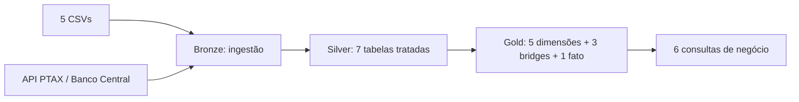
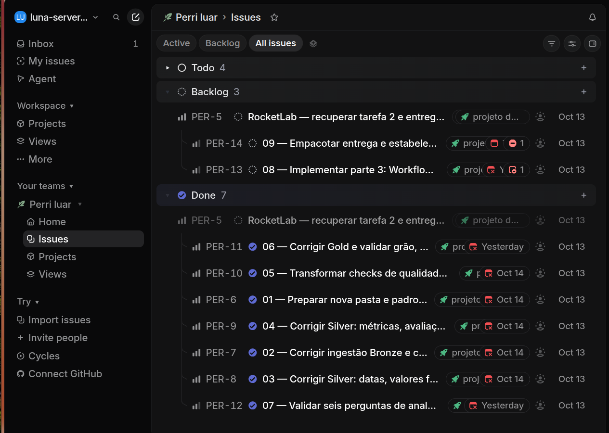
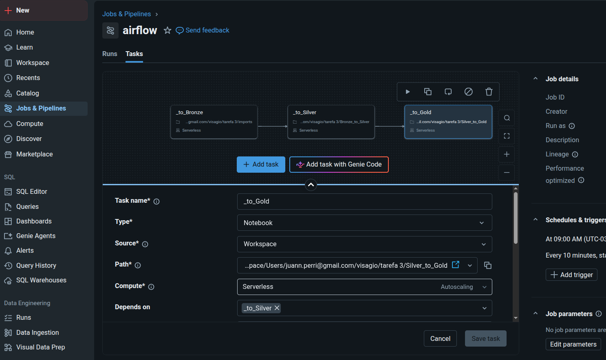
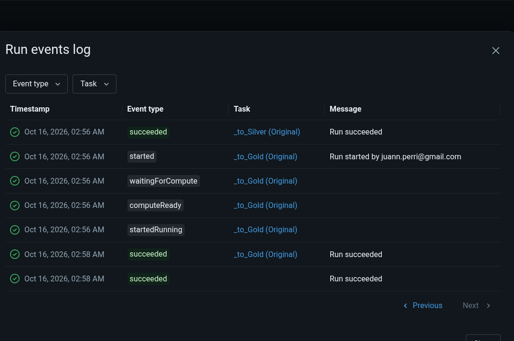
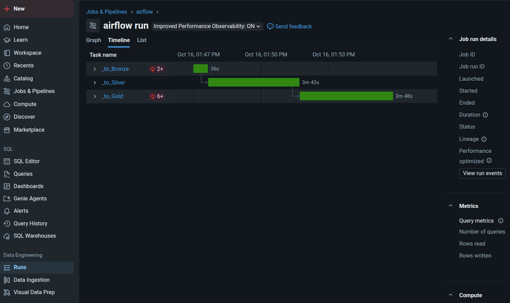

# CineData Analytics — Entrega 3

Pipeline de engenharia de dados desenvolvido para o RocketLab 2026.2, utilizando Databricks, PySpark, SQL e Delta Lake. O projeto organiza informações de filmes TMDB/IMDb em camadas Bronze, Silver e Gold, aplica regras de qualidade, relaciona filmes a gêneros, pessoas e produtoras e responde a seis perguntas de negócio.

**Autor:** Juan Perri. **Documentação e revisão:** 16/10/2026.

> Esta pasta reúne o código enviado em `tarefa 3.zip`, o YAML exportado, as evidências fornecidas e uma revisão de aderência ao enunciado. As capturas mostram execuções bem-sucedidas no Databricks. A revisão do código também identificou pendências; por isso, o projeto não é apresentado como integralmente validado. Consulte o [checklist da entrega](docs/CHECKLIST.md).

## Navegação

- [Checklist: feito, em andamento, a fazer e riscos](docs/CHECKLIST.md).
- [Passo a passo e nove tarefas do Linear](docs/LINEAR.md).
- [Arquitetura, regras e seis perguntas](docs/ARQUITETURA.md).
- [Preparação, execução e manutenção](docs/EXECUCAO.md).
- [Pesquisa, persona, few-shot e prompts](docs/METODOLOGIA_IA.md).
- [Base de conhecimento e fontes](base-conhecimento/README.md).
- [Galeria das 13 evidências](evidencias/README.md).
- [Revisão estática do código](docs/REVISAO.md).

## Como desenvolvi o trabalho

Organizei a atividade em etapas para conseguir implementar, conferir os resultados e voltar à origem dos problemas. Usei o Linear como roteiro: preparação dos notebooks, ingestão Bronze, tratamento Silver, qualidade, modelagem Gold, analytics, orquestração e organização da entrega.

No uso de IA, defini uma persona de **engenheiro de dados pleno/sênior** para orientar a revisão técnica. Apresentei a questão, o contexto e o código que já tinha desenvolvido, pedindo um passo a passo organizado em tarefas no Linear. O objetivo foi aprender com as correções, entender as funções utilizadas e validar cada etapa.

Também utilizei pesquisas no **Perplexity** e na internet com agentes de IA para encontrar exemplos de funções, comparar abordagens e melhorar a precisão dos prompts. Esse histórico é relatado por mim; os links individuais de todas as buscas e os prompts originais não fazem parte do ZIP. A documentação distingue esse relato dos arquivos e resultados verificáveis.

A abordagem de prompting combinou persona, contexto, decomposição e, conforme meu relato, exemplos no estilo **few-shot**. Especificar uma questão e pedir etapas, isoladamente, não caracteriza few-shot: a técnica envolve exemplos de entrada e saída esperada. Os [modelos de prompts](docs/METODOLOGIA_IA.md) apresentam exemplos reproduzíveis, identificados como modelos documentais, sem fingir que são transcrições das conversas originais.

Como referência de organização da pesquisa, utilizei o artigo de Mehul Gupta, [Andrej Karpathy’s LLM Knowledge Bases explained](https://medium.com/data-science-in-your-pocket/andrej-karpathys-llm-knowledge-bases-explained-2d9fd3435707). A adaptação neste repositório reúne fontes, decisões, exemplos, evidências e pendências em Markdown. É uma base documental; não há implementação de RAG ou treinamento de modelo neste pacote.

## Organização por partes

1. **Entender o contrato:** conferir o enunciado oficial e diferenciar requisitos de anotações de aula.
2. **Ingerir:** carregar os cinco CSVs e consultar a PTAX do Banco Central.
3. **Tratar:** normalizar datas, status, valores, métricas, avaliações, gêneros e entidades na Silver.
4. **Modelar:** criar dimensões, bridges e fato, preservando o grão de um filme.
5. **Responder:** executar as seis consultas sobre as tabelas Gold persistidas.
6. **Orquestrar:** configurar dependências e agendamento no Databricks.
7. **Documentar e revisar:** reunir código, fontes, evidências e checklist para publicação.

## Arquitetura



O diagrama representa o fluxo requerido. O YAML recebido possui uma divergência: `_to_Bronze` aponta para `imports`, que prepara schemas e faz um experimento com câmbio, mas não executa a ingestão dos CSVs. O arquivo que contém essa ingestão é `Landing_to_Bronze`. Esse ajuste precisa ser feito e validado no Job; não foi aplicado silenciosamente nesta documentação.

## O que foi implementado

- Bronze com escrita Delta em append e `ingestion_datetime` nos cinco conjuntos de filmes e na tabela de cotação.
- Silver com sete tabelas, tradução de status, conversões seguras, tratamento financeiro com decimais, forward fill da cotação e tratamento de ausências.
- Correção de representações financeiras como `34.0M` e tratamento pontual de popularidades identificadas como inconsistentes.
- Gold com dimensões, bridges, fato restrita a lançamentos realizados e verificações de integridade em partes do notebook.
- Seis consultas de analytics, incluindo `RANK`, desempate do top 10 e janelas baseadas no último lançamento realizado da base.
- Job com três tarefas e dependências explícitas, acompanhado de registros de execução fornecidos pelo autor.

“Implementado” significa localizado no código. Os arquivos exportados não incluem saídas de execução, e esta revisão não executou o pipeline no Databricks.

## Evidências do processo

### Planejamento no Linear



A captura mostra um momento intermediário. Na consulta ao Linear em 16/10/2026, PER-6 a PER-14 estavam em `Done`. Esse status registra o acompanhamento do trabalho; a aderência técnica é avaliada separadamente no checklist.

### Dependências no Databricks



### Execução registrada





As imagens registram sucesso e sequência das tarefas. Não demonstram, sozinhas, a atualização de todos os dados ou a aprovação de todas as regras de qualidade. Não foi estabelecida uma correspondência de hash entre o código do ZIP e o código executado em cada captura.

## Estrutura do repositório

```text
cinedata-entrega-3/
├── README.md
├── job.yaml                 # cópia exata de jobs.yaml recebido
├── notebooks/               # 3 ipynb convertidos + módulos auxiliares
├── src/                     # 6 arquivos Python originais do ZIP
├── docs/                    # checklist, revisão, Linear e guias
├── base-conhecimento/       # índice de pesquisa e decisões
└── evidencias/              # 13 capturas reais, sem alteração
```

Os três `.ipynb` foram convertidos dos exports Databricks `.py`, preservando a ordem e a lógica das células, sem fabricar outputs. `src/` mantém os originais. Os CSVs do ZIP não foram duplicados no pacote; a lista dos arquivos está no guia de execução. As aulas e o enunciado foram usados como referência documental, sem republicar os PDFs.

## Estado da entrega

A documentação, as evidências, o código original e os notebooks estão organizados. Antes de considerar a entrega tecnicamente concluída, precisam ser resolvidos: caminho de Volume, widgets PTAX, apontamento da Bronze no Job, checks bloqueantes na Silver e consolidação dos blocos repetidos da Gold. Há outras verificações detalhadas no [checklist](docs/CHECKLIST.md).

O enunciado oficial lista **cinco dimensões**, três bridges e uma fato: nove objetos Gold. A menção a seis dimensões/dez objetos no planejamento do Linear é uma divergência do plano. Views para consumo, materialized views e LLM-as-a-judge aparecem nas anotações como possibilidades de evolução; não foram identificados como funcionalidades implementadas.

Para preparar o ambiente, executar as camadas e publicar esta pasta, siga [EXECUCAO.md](docs/EXECUCAO.md).
